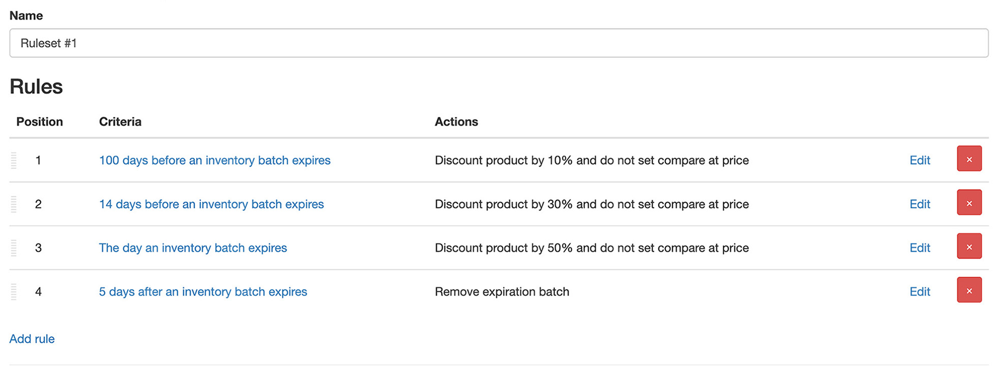

import Link from '@site/src/components/ProductExpirationDates/Link';

# 对即将到期的产品打折销售

当产品的某个库存批次进入设定的到期时间范围时，可以对其进行打折销售。配置折扣有两种方式：1) [传统方法](/docs/product-expiration-dates/discounts#legacy-discounts) 2) [规则集](/docs/product-expiration-dates/discounts#rulesets)。规则集是推荐的配置方式，它支持设置多阶段的阶梯折扣。例如：在到期前 100 天享受 9 折优惠（减价 10%），随后在到期前 5 天享受 7 折优惠（减价 30%）。

请参阅下方关于每种方式的详细文档。

## 规则集 {/* #rulesets */}

***规则集仅在<Link path="/charges/recurring/new">白金版套餐</Link>下提供***

规则集允许您定义一组应用于产品的条件，并在条件满足时执行相应的操作。规则集不仅可用于打折，还可用于添加或移除标签、更改产品标题等！来看一个具体示例。假设您希望按以下规则对产品进行打折：

-   到期前 100 天：打 9 折（减价 10%）
-   到期前 14 天：打 7 折（减价 30%）
-   到期当天：打 5 折（减价 50%）
-   到期后 5 天：移除已到期的批次

只需创建一个包含 4 条规则的规则集即可实现此目的。每条规则将包含设定的条件（到期前 100 天、到期前 14 天等）以及操作（减价 10%、减价 30% 等）。当某条规则的条件被满足时，系统就会执行其关联的操作。

**注意：**折扣百分比是基于应用打折时的产品现价计算的。如果您希望始终基于打折前的原价计算，则必须在每个阶段的“添加折扣”操作旁同时添加一个“移除折扣”操作。

### 到期前 100 天：打 9 折（减价 10%）

1.  前往<Link path="/inventory_rules/rule_sets">规则集页面</Link>
2.  点击“添加规则集”
3.  在“新建规则集”页面中为规则集输入名称
4.  点击 <kbd>保存</kbd>
5.  页面将跳转至新规则集的详情页，您可以在此添加打折规则
6.  点击“添加规则”
7.  在“条件”字段中选择“库存批次到期前”
8.  在“到期前天数”字段中输入 100
9.  在下方的“操作”区域中，选择“添加折扣”
10. 在“折扣百分比”字段中输入 10。如需将 Shopify 上的原价设为打折前的价格，请勾选“将常规售价用作原价 (Compare-at price)”
11. 点击 <kbd>保存</kbd>
12. 现在该规则集已有 1 条规则，接下来还需添加 3 条规则

### 到期前 14 天：打 7 折（减价 30%）

1.  在规则集的“编辑规则集”页面中，点击“添加规则”
2.  在“条件”字段中选择“库存批次到期前”
3.  在“到期前天数”字段中输入 14
4.  在“操作”区域中，选择“添加折扣”
5.  在“折扣百分比”字段中输入 30
6.  点击 <kbd>保存</kbd>
7.  现在该规则集已有 2 条规则，接下来还需添加 2 条规则

### 到期当天：打 5 折（减价 50%）

1.  在规则集的“编辑规则集”页面中，点击“添加规则”
2.  在“条件”字段中选择“库存批次到期后”
3.  在“到期后天数”字段中输入 0。这会将触发条件设定为产品到期当天
4.  在“操作”区域中，选择“添加折扣”
5.  在“折扣百分比”字段中输入 50
6.  点击 <kbd>保存</kbd>
7.  规则集已包含 3 条规则，还差最后 1 条！

### 到期后 5 天：移除已到期的批次

1.  在规则集的“编辑规则集”页面中，点击“添加规则”
2.  在“条件”字段中选择“库存批次到期后”
3.  在“到期后天数”字段中输入 5。这会将触发条件设定为产品到期后第 5 天
4.  在“操作”区域中，选择“移除库存批次”
5.  点击 <kbd>保存</kbd>

最终配置完成的规则集如下图所示：

该规则集将默认应用于店铺内的所有产品。您可以在创建规则时选择“匹配特定产品”条件，将其限制为特定产品或多属性。当即将到期的批次库存售罄后，规则集将被撤销，产品/多属性的价格将恢复至规则 1 匹配时的价格。

除非勾选了“追溯应用”选项（见下文），**否则规则集中的规则必须严格按照定义的顺序依次匹配。**例如，只有在规则 1 和规则 2 先后匹配成功后，规则 3 才会触发匹配。

## 追溯匹配 {/* #ruleset-retroactive-matching */}

在常规情况下，规则集必须从匹配第一条规则开始才能对库存批次生效。如果某个批次已经超过了第一条规则的时间节点（例如在添加该批次之后才创建了规则集），该规则集将永远不会对其生效。

勾选“追溯应用”选项后，批次可以直接加入规则集并触发与其当前日期匹配的任何规则，同时系统会一次性执行之前所有规则的操作。以上文示例中的规则集为例：对于距离到期仅剩 10 天的产品，系统会在一次处理中同时执行规则 1 和规则 2 及其关联的操作；对于已过期 2 天的批次，即使规则 1 和规则 2 本身的时间条件已不再单独满足，系统也会同时执行规则 1、2、3。

在此次初始追溯匹配完成后，后续各规则将按正常流程应用（即与未勾选“追溯应用”时的执行逻辑相同）。

## 传统折扣方法 {/* #legacy-discounts */}

***传统折扣功能仅在<Link path="/charges/recurring/new">专业版套餐</Link>下提供***

传统折扣可以按产品所属系列、产品类型或在单个产品上进行配置。折扣激活后将持续有效，直到所有即将到期的库存售完，或者适用的到期日被修改从而不再处于设定的打折时间范围内。

**默认情况下，折扣将应用于该产品的所有可售数量。**例如，如果您共有 10 件产品且只有 3 件即将到期，提供折扣时顾客仍能以打折价格购买全部 **10** 件商品。这是由 Shopify 产品定价机制决定的。如果您希望仅对即将到期的数量提供折扣，我们有多种备选方案。请[联系支持团队](https://screenstaring.com/#contact)以讨论具体方案，并确定最适合您店铺的做法。

折扣生效或价格恢复可能需要几分钟时间才能反映在您的网店前台。

## 按单个产品启用

1.  对于需要打折的产品，先将它的[到期日录入](/docs/product-expiration-dates/adding-expiration-data)应用
2.  在应用内的产品页面上，点击“折扣”选项卡
3.  在“折扣”选项卡中，勾选“当库存批次处于到期时间范围内时提供折扣”
4.  在“折扣百分比”字段中，输入您希望对产品常规价格进行折减的百分比。  
    例如，如果产品售价为 50，在此输入 10，则折扣激活时该产品将以 45 的价格销售。
5.  在“到期前打折天数”字段中，输入您希望在产品到期前几天激活折扣。  
    例如，如果产品的到期日为 1 月 15 日且输入了 10，则从 1 月 5 日开始该产品将自动享受折扣。
6.  点击 <kbd>保存</kbd> 按钮

## 按产品系列启用

1.  对于需要打折的产品，先将它的[到期日录入](/docs/product-expiration-dates/adding-expiration-data)应用
2.  在应用内的产品页面上，点击“折扣”选项卡
3.  在“折扣”选项卡中，勾选“当库存批次处于到期时间范围内时提供折扣”
4.  在“折扣百分比”字段中，输入您希望对产品常规价格进行折减的百分比。  
    例如，如果产品售价为 50，在此输入 10，则折扣激活时该产品将以 45 的价格销售。
5.  “到期前打折天数”字段请留空。该数值将在后续配置产品系列时录入
6.  点击 <kbd>保存</kbd> 按钮
7.  在应用设置中前往<Link path="/settings#discounts">“折扣”</Link>
8.  找到“按产品系列”区域
9.  在“标题”字段中，选择您要为其配置折扣的产品系列
10. 在“到期前天数”字段中，输入该系列产品在到期前多少天触发折扣。这将决定何时激活折扣。  
    例如，如果产品到期日为 1 月 15 日且输入了 10，则折扣将从 1 月 5 日开始生效。
11. 如需添加其他产品系列，点击“添加更多”链接
12. 点击 <kbd>更新</kbd> 按钮

## 按产品类型启用

1.  对于需要打折的产品，先将它的[到期日录入](/docs/product-expiration-dates/adding-expiration-data)应用
2.  在应用内的产品页面上，点击“折扣”选项卡
3.  在“折扣”选项卡中，勾选“当库存批次处于到期时间范围内时提供折扣”
4.  在“折扣百分比”字段中，输入您希望对产品常规价格进行折减的百分比。  
    例如，如果产品售价为 50，在此输入 10，则折扣激活时该产品将以 45 的价格销售。
5.  “到期前打折天数”字段请留空。该数值将在后续配置产品类型时录入
6.  点击 <kbd>保存</kbd> 按钮
7.  在应用设置中前往<Link path="/settings#discounts">“折扣”</Link>
8.  找到“按产品类型”区域
9.  在“产品类型”字段中，选择您要为其配置折扣的产品类型。列表仅显示已录入应用的产品类型
10. 在“到期前天数”字段中，输入属于该产品类型的产品在到期前多少天触发折扣。这将决定何时激活折扣。  
    例如，如果产品到期日为 1 月 15 日且输入了 10，则折扣将从 1 月 5 日开始生效。
11. 如需添加其他产品类型，点击“添加更多”链接
12. 点击 <kbd>更新</kbd> 按钮
