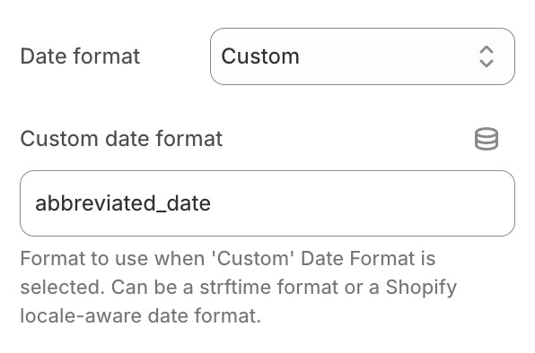

# 根据所选国家/地区动态调整日期格式

到期日显示格式可以根据用户所选的国家/地区进行动态切换。具体取决于 Shopify 后台[模版内容编辑器](https://help.shopify.com/zh-CN/manual/online-store/themes/customizing-themes/language/change-wording#overview-of-the-language-editor)中配置的日期格式。

如果您正在使用[我们的 Shopify 模版集成功能](/docs/product-expiration-dates/shopify-pages)，可以通过在“Date format”（日期格式）字段中选择“Custom”（自定义），并输入适配 Shopify 语言区域的日期格式名称来实现。例如，如果您要使用的格式名称为 `abbreviated_date`，可进行如下配置：

Shopify 限制可使用的日期格式名称必须为以下之一：

-   `abbreviated_date`
-   `basic`
-   `date`
-   `date_at_time`
-   `default`
-   `on_date`
-   `short`
-   `long`

虽然可以使用自定义格式名称，但它们无法直接在 Shopify 模版编辑器集成中使用。在此情况下，您必须[手动将代码片段添加到您的模版中](/docs/product-expiration-dates/shopify-pages#adding-liquid-snippet)，并通过 `{{ allocation.time | date: format: "your_format_name" }}` 明确指定格式名称。
