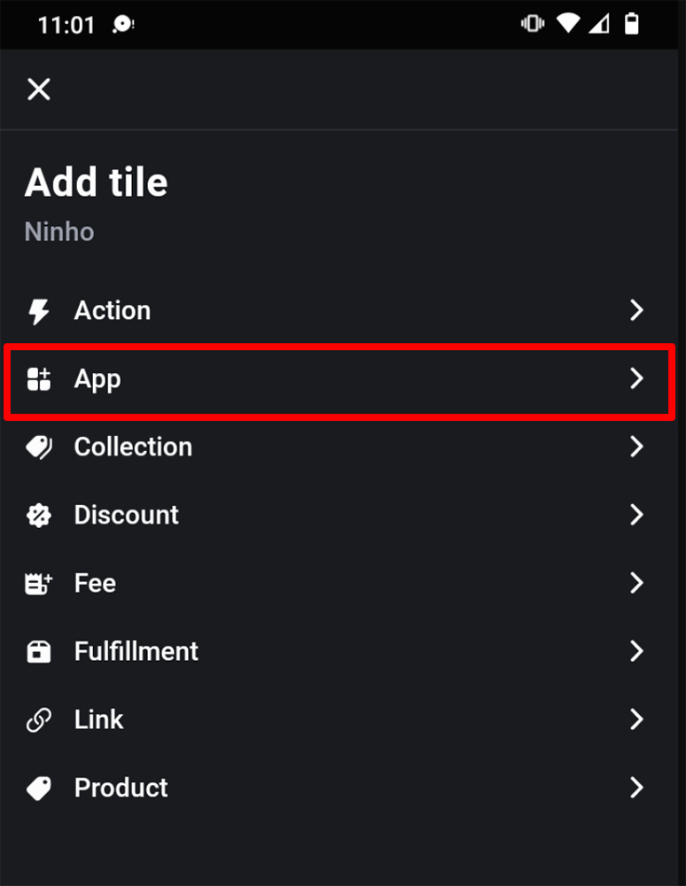
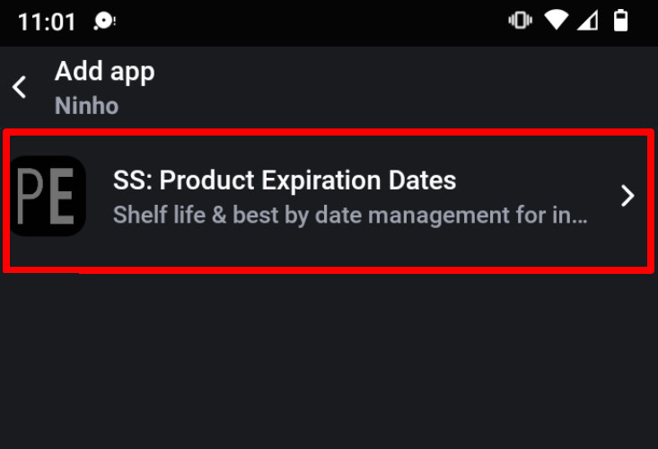
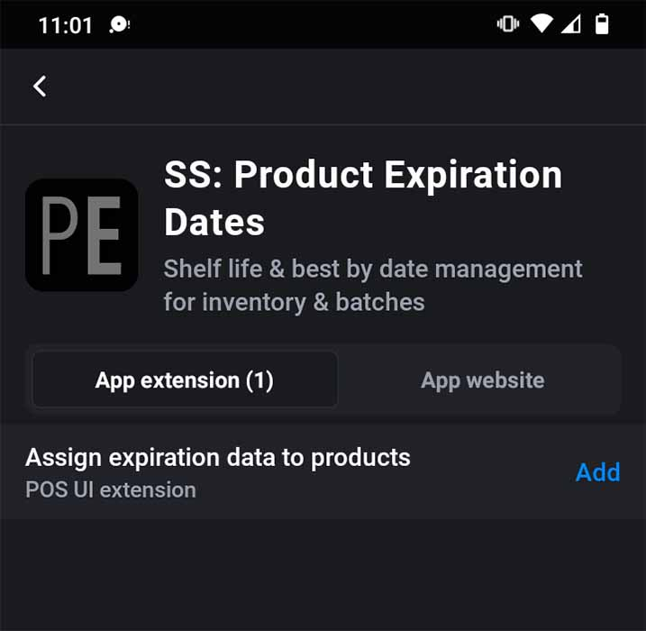
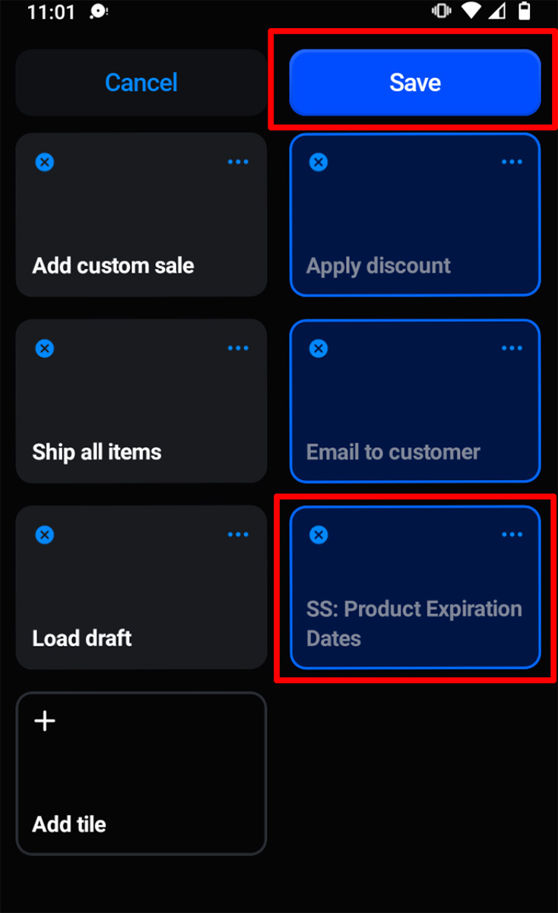

import Link from '@site/src/components/ProductExpirationDates/Link';

# Shopify POS（销售点）集成

***Shopify POS 集成仅在<Link path="/charges/recurring/new">白金版套餐</Link>下提供***

通过我们的 Shopify POS 集成，您可以在 Shopify POS 应用程序内直接为订单分配库存批次。安装时，只需将 Product Expiration Dates 应用添加为 POS 主屏幕上的快捷功能方块即可：

1.  在 POS 主屏幕上，点击“添加功能方块”并选择“应用”：
    
    
    
2.  在应用列表中选择“SS: Product Expiration Dates”：
    
    
    
3.  在“为产品添加到期数据”旁点击“添加”：
    
    
    
4.  此时 POS 主屏幕上将显示“SS: Product Expiration Dates”功能方块：
    
    
    
5.  点击“保存”

现在，当购物车中有商品时，您可以点击“SS: Product Expiration Dates”功能方块为其分配库存批次。系统展示的批次将来自该 POS 终端当前所在的地点。
