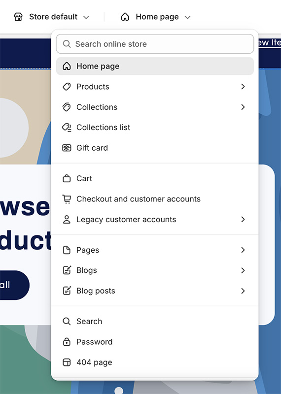
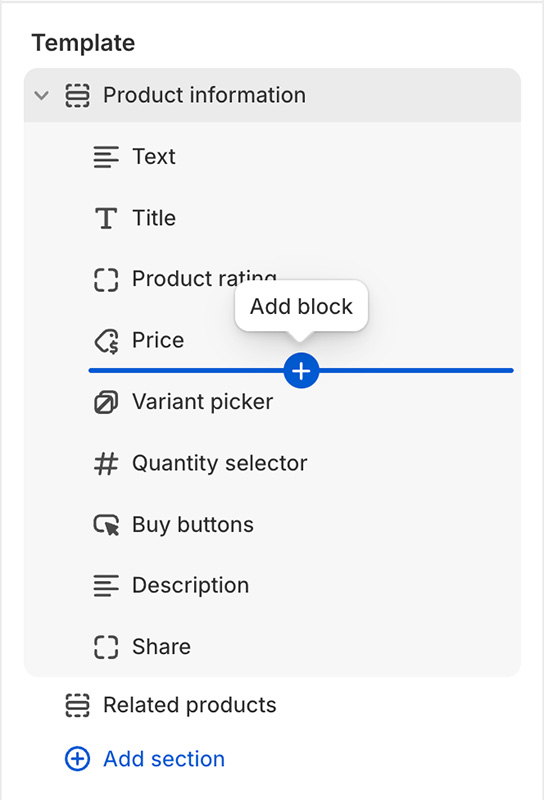
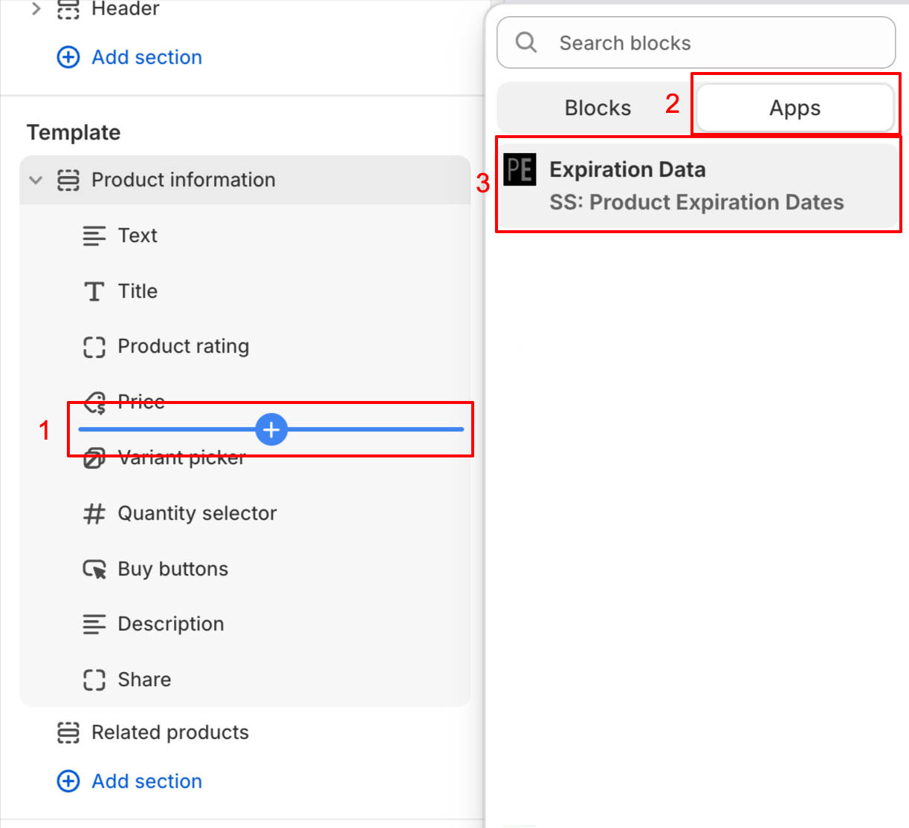
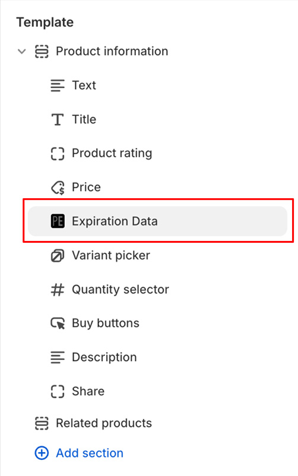

import ShopifyLink from '@theme/ShopifyAdminLink';
import ShopifyCurrentTheme from '@site/src/components/ShopifyCurrentTheme';

# 在网店中添加到期数据

您可以直接在网店前台访问和/或展示到期数据，包括到期日、对应批次数量以及开封后使用期限信息。展示这些信息最简便的方法是使用我们的 [Shopify 模版编辑器](https://help.shopify.com/zh-CN/manual/online-store/themes/customizing-themes/theme-editor/using-the-theme-editor#access-the-theme-editor) 集成，它可以将到期数据[作为分区或分块](https://help.shopify.com/zh-CN/manual/online-store/themes/customizing-themes/theme-editor/using-the-theme-editor#sections-and-blocks)直接添加到页面中。

1.  在模版编辑器中<ShopifyCurrentTheme>打开您的模版</ShopifyCurrentTheme>
1.  在模版编辑器中，选择您希望添加到期数据的页面模版：

    

1.  在模版中选择期望的展示位置。将鼠标悬停在目标插入区域即可：

    

1.  点击“添加分块”按钮，并在“应用”区域中选择“Expiration Data”：

    

1.  这将在所选模版中添加一个 Expiration Data 分块：

    

1.  点击 Expiration Data 分块可调整更多配置选项。对于包含多个多属性的产品，系统将展示当前选中多属性的到期数据。您还可以添加多个分块以满足不同的展示需求。例如，添加 1 个分块展示到期日，再添加 1 个分块展示开封后使用期限数据。
1.  点击 <kbd>保存</kbd>

## 向模版中添加代码片段 {/* #adding-liquid-snippet */}

**推荐优先通过[我们的 Shopify 模版集成功能](/docs/product-expiration-dates/shopify-pages)添加到期数据。只有在特定定制需求下，才需要显式手动添加代码片段。**

1.  <ShopifyLink href={(shopify) => shopify.toString()}>前往 Shopify 后台</ShopifyLink>
2.  [打开模版代码编辑器](https://shopify.dev/docs/storefronts/themes/tools/code-editor#accessing-the-code-editor)
3.  [添加新的模版文件](https://shopify.dev/docs/storefronts/themes/tools/code-editor#adding-theme-files)
    -   点击“snippets”（代码片段）目录
    -   点击“添加新的代码片段”
    -   文件名输入 `ss-product-expiration-dates`
    -   点击“完成”
4.  编辑器中将打开一个名为 `snippets/ss-product-expiration-dates.liquid` 的新空白标签页
5.  复制[我们的 Liquid 代码片段](/product-expiration-dates/images/ss-product-expiration-dates.txt)中的全部代码，并粘贴到该标签页中
6.  点击 <kbd>保存</kbd>

## 展示到期数据

[将代码片段添加到模版](/docs/product-expiration-dates/shopify-pages#adding-liquid-snippet)后，下一步是在您希望显示到期数据的位置进行渲染。此操作可在 Shopify 后台通过模版自定义页面完成。

1.  在模版编辑器中<ShopifyCurrentTheme>打开您的模版</ShopifyCurrentTheme>
1.  在模版编辑器中依次选择“产品” > “默认产品”（或您希望配置的其他模版）
1.  在“模版”区域点击“添加分块”
1.  选择“自定义 Liquid”；若无该选项，可选择“HTML”（注意所选“HTML”分块需支持 Liquid 语法）

-   如果您的模版既无“自定义 Liquid”也无“HTML”选项，则必须手动在模版代码中渲染该代码片段
-   该操作可通过[模版代码编辑器](https://shopify.dev/docs/themes/tools/code-editor)完成
-   如果您需要协助，请[联系支持团队](https://screenstaring.com/#contact)

1.  添加完成后，您可以将该自定义 Liquid 分块拖动到希望展示到期数据的具体位置
1.  点击刚添加的自定义 Liquid 分块
1.  在“自定义 Liquid”（或类似名称）文本框中粘贴相应的渲染代码，示例请参阅下文的到期数据显示选项
1.  点击 <kbd>保存</kbd>

## 根据用户语言/地区展示到期日 {/* #display-language-region */}

如果您的网店支持多语言，可以根据顾客当前选择的语言和/或地区动态调整到期日格式和提示文本。无需使用默认代码渲染到期日：

```liquid
{% render "ss-product-expiration-dates", product: product, prefix: "Best by:", format: "%B %d, %Y" %}
```

您可以使用以下代码检查当前选中的语言和/或地区，并以特定格式展示到期日与文本：

```liquid



  {% render "ss-product-expiration-dates", product: product, prefix: "Consúmase antes de:", format: "%d/%m/%Y" %}

  {% render "ss-product-expiration-dates", product: product, prefix: "Mindestens haltbar bis:", format: "%d.%m.%Y" %}

  {% render "ss-product-expiration-dates", product: product, prefix: "Best by:", format: "%B %d, %Y" %}

```

在上述代码中，如果语言为西班牙语（`"es"`），则显示文本 `"Consúmase antes de:"`，且日期采用 `DD/MM/YYYY` 格式；如果语言为德语（`"de"`），则文本和日期将以适合德语用户的格式展示；如果均不满足，则以适合英语用户的格式展示。

如果您希望同时结合用户的语言**和**国家/地区来展示文本，可以添加针对 `locale` 变量的判断分支。在以下示例中，若用户位于西班牙，日期将采用 `YYYY/MM/DD` 格式；若位于其他西班牙语国家，则采用 `DD/MM/YYYY` 格式展示：

```liquid



  {% render "ss-product-expiration-dates", product: product, prefix: "Consúmase antes de:", format: "%Y/%m/%d" %}

  {% render "ss-product-expiration-dates", product: product, prefix: "Consúmase antes de:", format: "%d/%m/%Y" %}

  {% render "ss-product-expiration-dates", product: product, prefix: "Mindestens haltbar bis:", format: "%d.%m.%Y" %}

  {% render "ss-product-expiration-dates", product: product, prefix: "Best by:", format: "%B %d, %Y" %}

```
