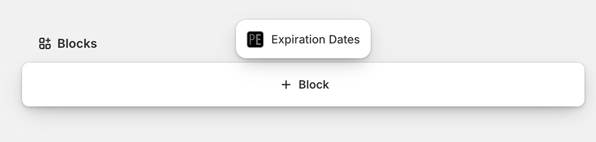
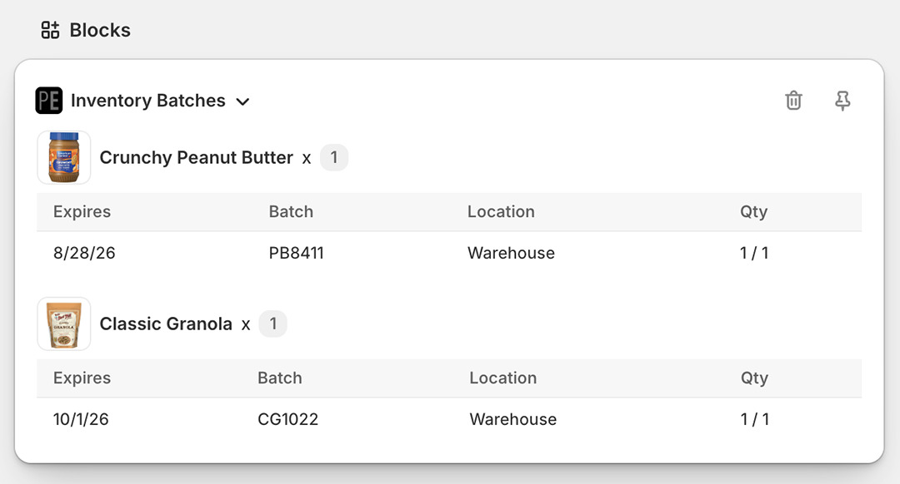
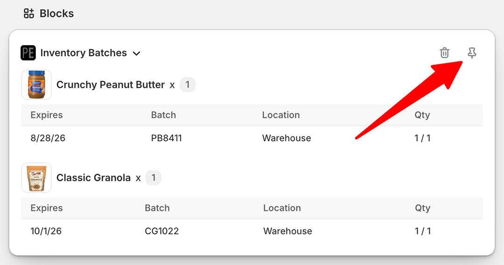
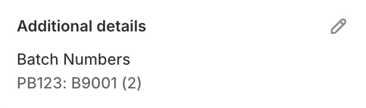

import Link from '@site/src/components/ProductExpirationDates/Link';

# 在 Shopify 后台中查看订单到期日和批次号

直接在 [Shopify 后台的订单页面](https://help.shopify.com/zh-CN/manual/orders/manage-orders#view-an-order)中，可以通过多种方式查看分配给该订单的批次号与到期日。

## 后台分块

在订单页面添加 Expiration Dates 分块的步骤如下：

1.  在 [Shopify 后台](https://help.shopify.com/zh-CN/manual/orders/manage-orders#view-an-order)中打开目标订单
2.  在订单页面滚动至底部，点击“添加分块”

    

3.  在弹出菜单中选择“Expiration Dates”
4.  页面将展示分配给该订单明细项的到期日（如果有）。请注意，仅有 2026 年 9 月 11 日**之后**创建的订单才会展示其到期日：

    

5.  若要让该分块固定常驻显示在订单页面上，请点击图钉图标：

    

## “其他详细信息”区域

批次号也可以添加到订单页面的“其他详细信息”区域中：

1.  在应用设置中前往<Link path="/settings#orders">“订单”选项卡</Link>
1.  勾选“创建包含订单库存批次的订单‘其他详细信息’条目”
1.  点击 <kbd>更新</kbd> 按钮保存设置

此后，新订单的库存批次信息将自动添加到 Shopify 后台订单页面的“其他详细信息”区域中：

   

其中包含以下信息：

- `PB123`：明细项的 SKU
- `B9001`：分配给该明细项的批次号
- `(2)`：数量

## 在应用中查看订单

若要直接在应用内打开订单页面：

1.  在 Shopify 后台中打开目标订单
2.  在订单页面右上角点击“更多操作”
3.  选择“Expiration Dates”
